# ServerControl RS

Настольная панель управления приватным сервером World of Claudecraft для Windows 10/11.

**Стек:** Rust · Tauri 2 · React 19 · TypeScript · PostgreSQL

## Что это

Панель для оператора приватного сервера. 15 вкладок, 106 команд, 1149 тестов — весь сервер в одном окне: мониторинг, модерация, экономика, бэкапы, логи.

## Скриншоты

### Дашборд

Состояние сервера: онлайн, CPU, RAM, тикрейт, спарклайны за сутки, перформанс подсистем.

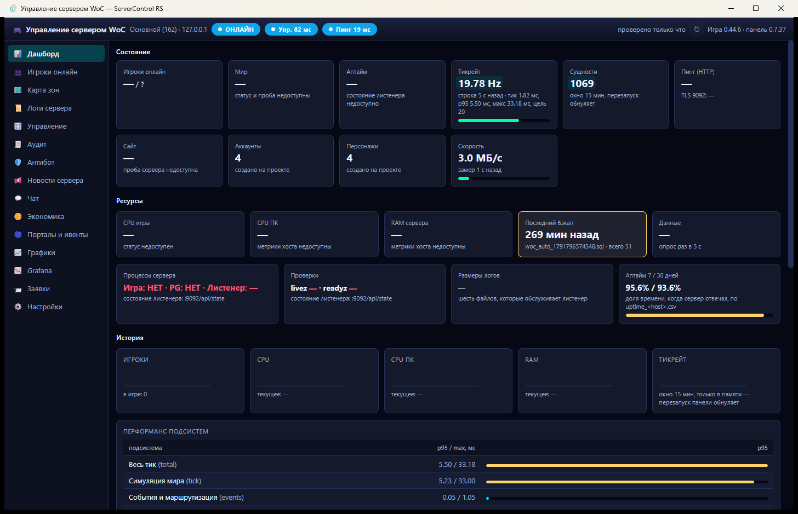

### Игроки онлайн

Таблица с фильтрами по классам, зонам, гильдиям. Карточка игрока: статы, спека, титулы, геолокация по IP.

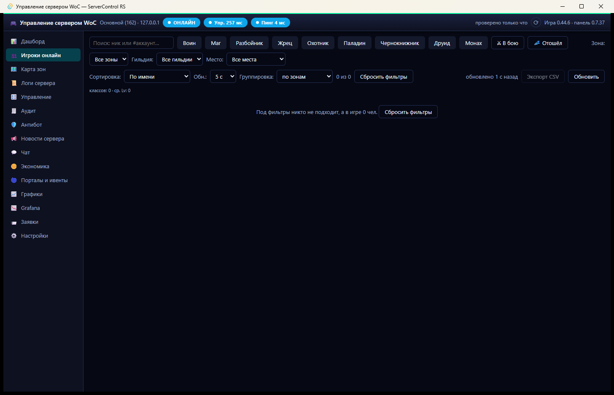

### Карта зон

Живая карта континента: зоны с уровнями, точки игроков, открытые порталы.

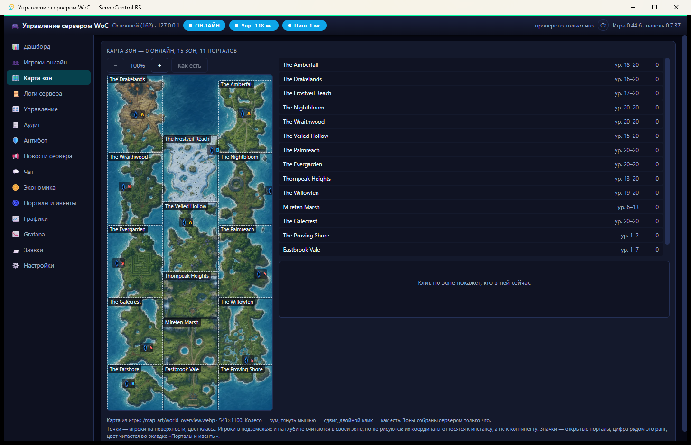

### Логи сервера

Семь логов (игровой, лаунчер, аудит, PostgreSQL, мосты) с фильтрами, поиском и экспортом.

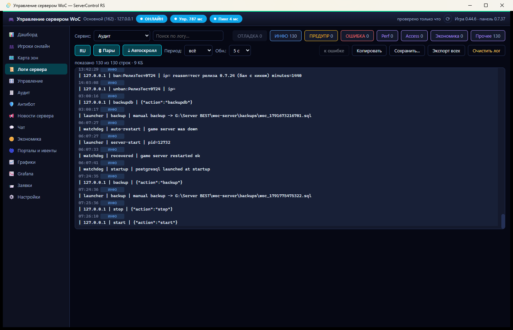

### Управление

Стоп / старт / рестарт, бэкапы БД, восстановление, плановый рестарт, баны.

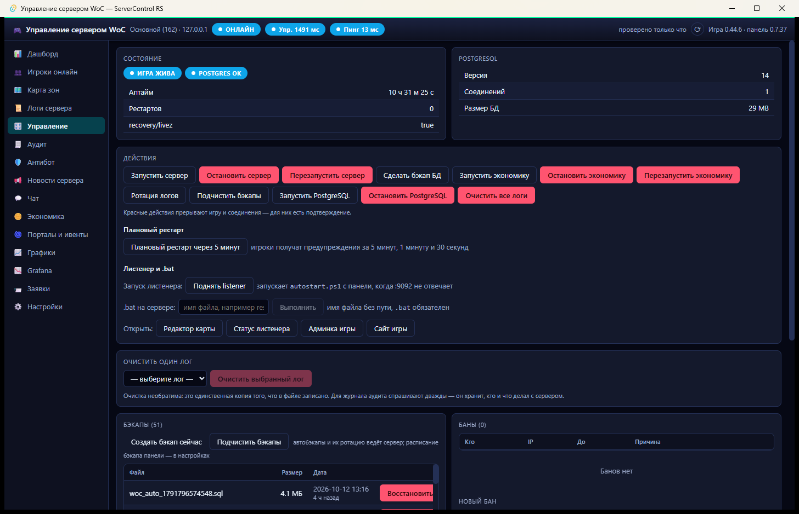

### Антибот

Детектор подозрительных с уликами, IP-бан, чит-марк, блокировка от мировых квестов.

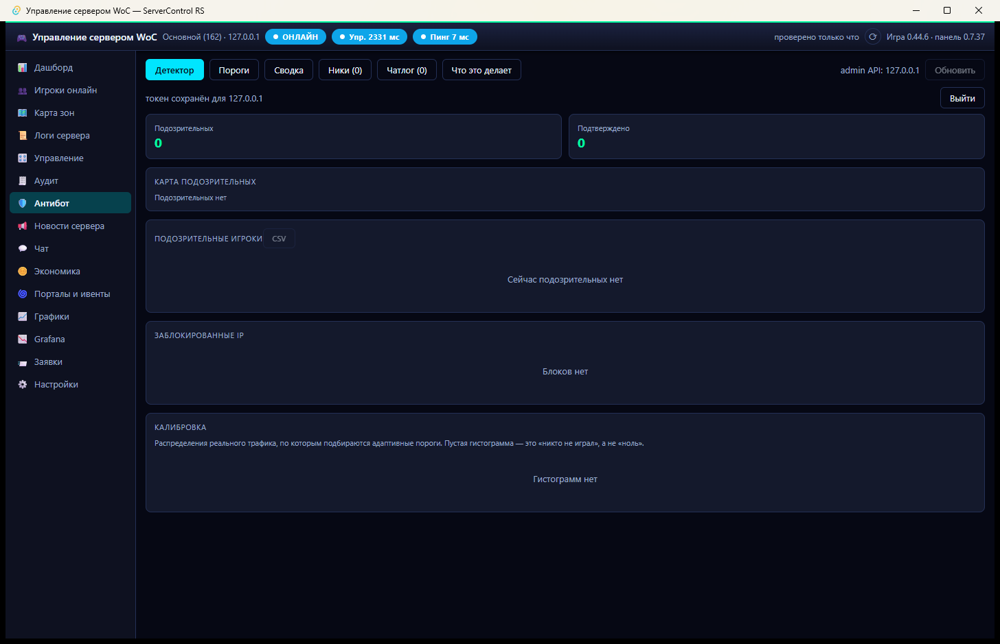

### Новости сервера

Rich-text объявления с картинкой, расписанием и журналом доставки.

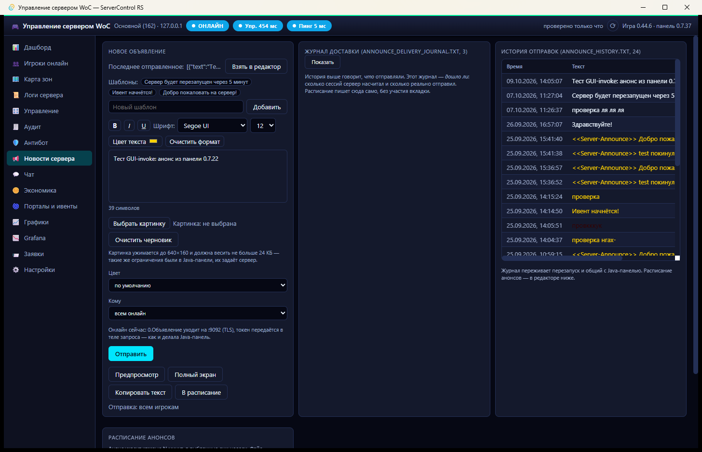

### Чат

Игровая переписка: фильтры, ЛС, быстрые ответы, кик / бан из строки.

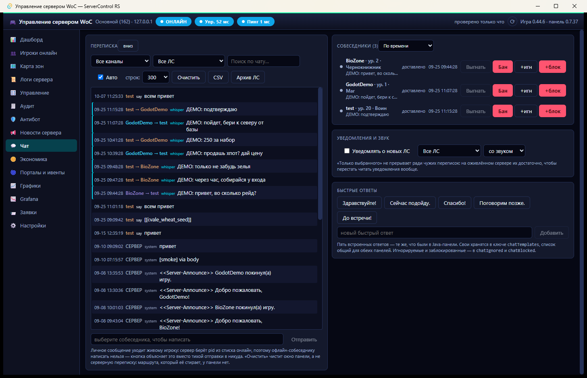

### Экономика

Аккаунты Claudium, каталог цен, леджер, магазин, топы, CSV.

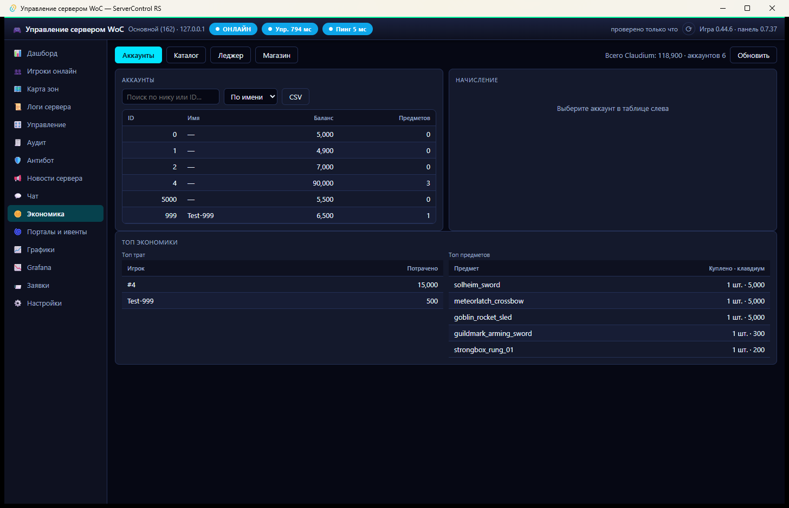

### Графики

История CPU, RAM, онлайн, пинг. Фоновый сэмплер пишет каждые 60 секунд.

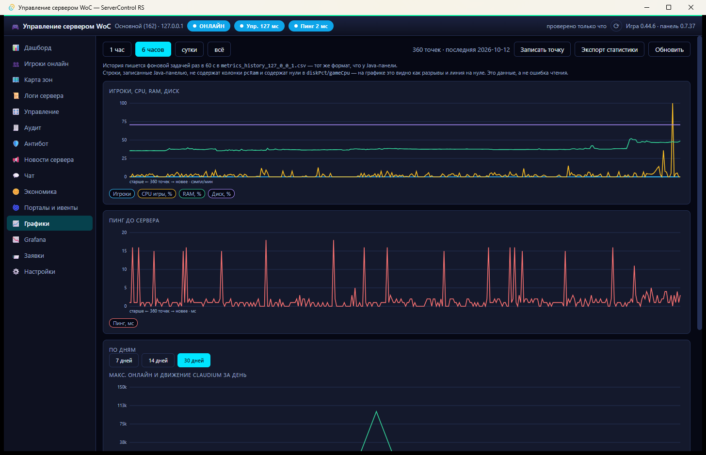

### Порталы и ивенты

Открытые порталы с таймерами и координатами.

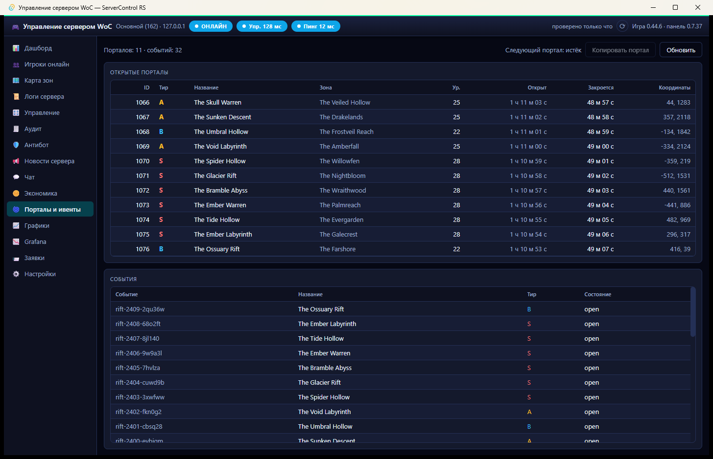

### Заявки магазина

Одобрение с начислением Claudium и анонсом.

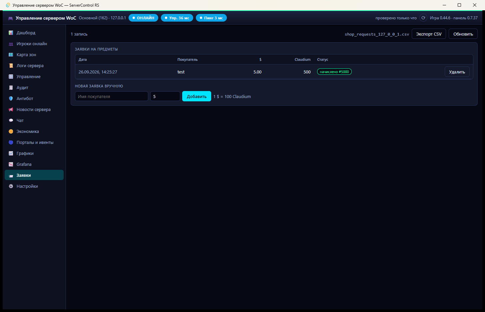

### Аудит

Журнал действий с фильтрами, топ IP, экспорт CSV.

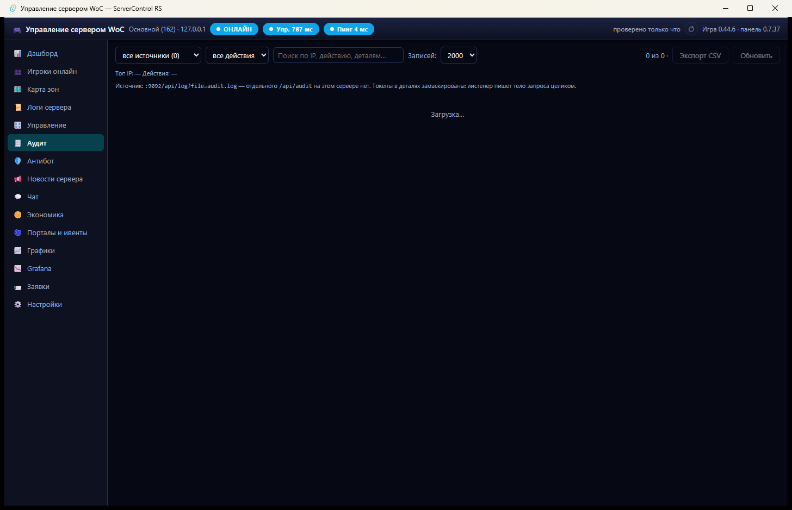

### Настройки

Профили серверов, секреты зашифрованы DPAPI, расписания, webhook.

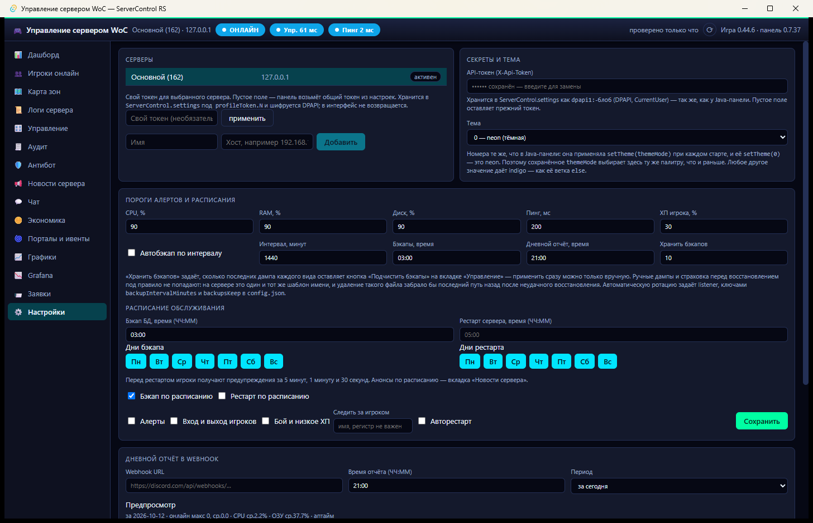

## Безопасность

Полный аудит 0.7.37: **14 уязвимостей исправлено, 0 осталось**. Секреты зашифрованы DPAPI Windows. Закрытый набор команд — никакого произвольного shell.

## Страница возможностей

**[promastermafia-dotcom.github.io/servercontrol-rs](https://promastermafia-dotcom.github.io/servercontrol-rs/)**

---

Исходный код панели не публикуется. Этот репозиторий — только страница возможностей.
